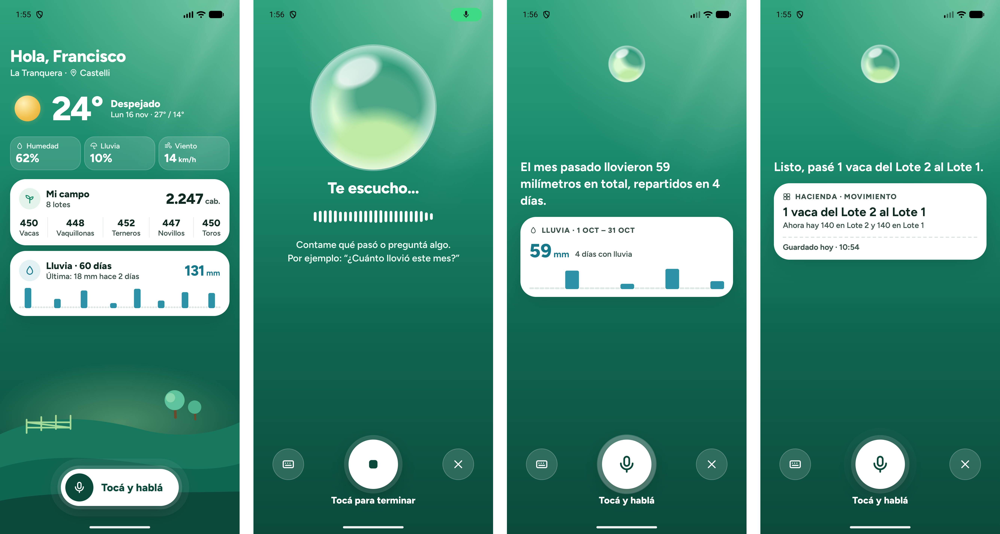
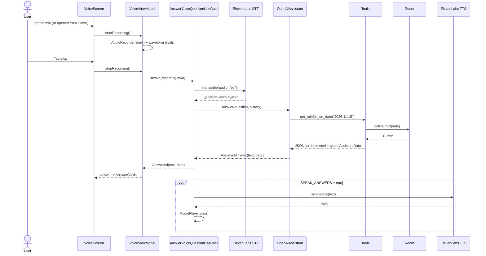

# Fildy

A voice-first field app for cattle farmers. Talk to it in Spanish to check rain and
herd data, or to record changes, hands-free while working in the field.

> *"¿Cuánto llovió este mes?"* · *"Mové 30 vacas del lote 1 al lote 2"* ·
> *"Anotá 18 mm de lluvia de ayer"* · *"¿Cuántas vacas hay en el lote 3?"*

The app is seeded with the challenge's minimum data: **La Tranquera**, a farm in Castelli, 
Buenos Aires, with 8 paddocks, about 450 head per category, and rain for the last 60 days.

---

## Screenshots



## Tech stack

| Area | Choice |
|---|---|
| Language / UI | Kotlin 2.4, Jetpack Compose |
| Architecture | MVVM + a use case for the voice pipeline, repositories over Room |
| Navigation | Navigation 3 |
| DI | Hilt (KSP) |
| Database | Room 2.8 (seeded from a bundled JSON on first launch) |
| LLM | OpenAI Java SDK 4.96 · Responses API + function calling (strict schemas) |
| Speech | ElevenLabs REST APIs: Scribe (`scribe_v2`) STT, `eleven_multilingual_v2` TTS |
| Networking | OkHttp 5, kotlinx.serialization |
| Build | AGP 9.4 (built-in Kotlin), Gradle 9.6 |
| Android | minSdk 30 · targetSdk / compileSdk 37 |

---

## Getting started

### 1. API keys

Add your keys to `local.properties`, which is not committed:

```properties
ELEVENLABS_API_KEY=your_elevenlabs_key
OPENAI_API_KEY=your_openai_key

# Optional: read answers out loud (default true). Set to false to save TTS credits while testing.
SPEAK_ANSWERS=true
```

Each value can also come from an **ENV var** with the same name, e.g. a CI/CD secret.
`local.properties` wins if both are set.

### 2. Build and run

```bash
./gradlew :app:installDebug
```

Or run the `app` configuration from Android Studio. The first launch fills the database from
`app/src/main/assets/seed/farm_seed.json`, and later launches keep your data.

### 3. Tests

```bash
./gradlew :app:testDebugUnitTest            # JVM unit tests
./gradlew :app:connectedDebugAndroidTest    # instrumented (Room, real SDK), needs a device/emulator
```

---

## Architecture

### Answering a spoken question

**Sequence Diagram**



**What you can ask or do**

| Tool | Example | Type |
|---|---|---|
| `get_rainfall_on_date` | "¿Cuánto llovió ayer?" | read |
| `get_rainfall_between_dates` | "¿Cuánto llovió este mes?" | read |
| `set_rainfall` | "Anotá 18 mm de lluvia de ayer" (one value per day, replaces) | write |
| `get_paddock_herd` | "¿Cuántas vacas hay en el lote 1?" | read |
| `move_cattle` | "Mové 30 vacas del lote 1 al lote 2" (checks stock) | write |
| `adjust_herd` | "Agregá 20 vacas al lote 1", "sacá 10 toros del lote 8", "en el lote 3 hay 155 vacas" | write |

---

## Project structure

```
app/src/main/java/com/fildy/
├── data/
│   ├── assistant/          # Assistant interface, tools, system prompt, typed AssistantData
│   │   ├── openai/         # OpenAI implementation (Responses API + function calling)
│   │   └── tools/          # One class per tool + shared schema helpers
│   ├── audio/              # AudioRecorder (MediaRecorder), AudioPlayer (MediaPlayer)
│   ├── local/              # Room database, entities, DAOs, relations
│   ├── model/              # Domain models (Farm, Paddock, RainfallRecord, StockChange…)
│   ├── repository/         # FarmRepository, RainfallRepository (+ Impl)
│   ├── seed/               # One-time database seeding from the bundled JSON
│   └── speech/             # SpeechToText / TextToSpeech interfaces + ElevenLabs
├── di/                     # Hilt modules (database, network, speech, assistant, audio…)
├── domain/voice/           # AnswerVoiceQuestionUseCase, ConversationHistory, settings
├── navigation/             # Navigation 3 keys and NavDisplay
└── ui/
    ├── components/         # VoiceOrb, VoiceButton, VoiceWaveform, DataCard, RainChart…
    ├── home/               # Header, weather, farm and rain cards (+ ViewModels)
    ├── theme/              # "Bosque" palette, Figtree typography, motion tokens
    └── voice/              # Voice screen, controls, answer cards (+ ViewModel)
```

---

## Notes and known limitations

- **Time zone:** the app always uses the farm's time zone, Buenos Aires (UTC-3), for "today",
  rain dates and saved times, whatever the phone is set to.
- **Weather** is still hardcoded, except for the date.
- **Seed dates are fixed.** The seeded rain slowly leaves the 60-day window as time passes.
- **Microphone permission:** if the user picks "Don't ask again", the app shows a message, but
  there's no shortcut to the system settings yet.
- **No fallback if ElevenLabs/OpenAI are down:** or if user has no internet connection.